# Roadmap Maestro de Transformación: PropFirm Tracker ➔ Tradelio Pro Suite
*Ingeniería Inversa basada en Análisis de Red (REA) sobre `app.tradelio.co.har` y `app.tradesyncer.com`*

---

## 1. Arquitectura de Pantallas y Módulos Descubierta en Tradelio

A través de la decodificación de chunks (`0u8w8_c-snrrr.js`) y endpoints backend (`api-v2.tradelio.co`), se descubrió la estructura exacta de 4 bloques temáticos de Tradelio:

```mermaid
graph TD
    Root["Tradelio App Hub"] --> B1["TRADING & RENDIMIENTO"]
    Root --> B2["PROP FIRMS & CUENTAS"]
    Root --> B3["AUTOMATIZACIÓN"]
    Root --> B4["RECURSOS & HERRAMIENTAS"]

    B1 --> P1["Dashboard Ejecutivo (/dashboard)"]
    B1 --> P2["Calendario PnL (/dashboard/calendar)"]
    B1 --> P3["Historial de Trades (/dashboard/trades)"]
    B1 --> P4["Analítica Cuantitativa (/dashboard/analytics)"]
    B1 --> P5["Estrategias (/dashboard/strategies)"]

    B2 --> C1["Cuentas de Fondeo (/dashboard/accounts)"]
    B2 --> C2["Distribución / Portfolio (/dashboard/portfolio)"]
    B2 --> C3["Fondeo & Gastos (/dashboard/funding)"]
    B2 --> C4["Tracker de Reglas (/dashboard/progress-tracker)"]

    B3 --> F1["Copiador de Futuros Tradovate (/dashboard/futures-copier)"]
    B3 --> F2["Copiador CFDs MT4/MT5 (/dashboard/copy-trading)"]

    B4 --> R1["Calendario Económico de Noticias (/dashboard/economic-calendar)"]
    B4 --> R2["Herramientas / Calculadoras (/dashboard/tools)"]
    B4 --> R3["Universidad de Fondeo (/dashboard/university)"]
```



---

## 2. Contratos de Datos y APIs Descubiertas (Tradelio Backend)

### A. Dashboard Ejecutivo (`GET /api/v1/accounts/{id}/metrics/dashboard`)
```json
{
  "overall_metrics": {
    "total_pnl": 0.0,
    "total_trades": 0,
    "win_rate": 0.0,
    "profit_factor": 0.0
  },
  "today_metrics": {
    "pnl": 0.0,
    "trades": { "wins": 0, "losses": 0 },
    "best_trade": null,
    "worst_trade": null
  },
  "consistency_metrics": {
    "avg_daily_pnl": 0.0,
    "best_day_pnl": 0.0,
    "worst_day_pnl": 0.0
  },
  "history": []
}
```

### B. Calendario PnL por Cuenta (`GET /api/v1/accounts/{id}/metrics/calendar?view_type=money|percent`)
- **Modo Dinero:** Ganancia o pérdida neta diaria (`+$520.00`, `-$150.00`).
- **Modo Porcentaje:** Rendimiento sobre el balance de la cuenta (`+1.04%`, `-0.30%`).
- **Desglose Diario:** Al hacer clic en el día, llama a `/api/v1/accounts/{id}/trades` para listar las operaciones ejecutadas en esa fecha.

### C. Calendario Económico de Noticias en Vivo (`GET https://chartevents-reuters.tradingview.com/events`)
- **Proveedor:** Reuters / TradingView API (Gratuito, público, sin CORS).
- **Parámetros:** `minImportance=1|2|3`, `from=YYYY-MM-DDTHH:mm:ssZ`.
- **Payload:**
```json
{
  "id": "16665728 2026-10-20 06:00:00 +0000 UTC ILO Unemployment Rate*",
  "title": "ILO Unemployment Rate*",
  "country": "GB",
  "currency": "GBP",
  "date": "2026-10-20T06:00:00.000Z",
  "importance": 1,
  "actual": null,
  "forecast": 5.0,
  "previous": 4.9,
  "unit": "%",
  "period": "Aug. 2026",
  "source": "ONS",
  "comment": "The unemployment rate..."
}
```
- **Niveles de Importancia:**
  * 🔴 **Alta (3):** NFP, IPC (CPI), Tasas FOMC, PIB (GDP).
  * 🟠 **Media (2):** Ventas minoristas, PMIs.
  * 🟡 **Baja (1):** Subastas, datos secundarios.

### D. Fondeo Global (`GET /api/v2/funding/dashboard`)
```json
{
  "summary": {
    "total_profit": "0.00",
    "total_withdrawals": "0.00",
    "total_exam_cost": "0.00",
    "global_roi": null
  },
  "monthly_evolution": [],
  "props_ranking": []
}
```

### E. Integración Tradovate OAuth Oficial (`POST /api/v1/account-sync/tradovate/oauth/url`)
```json
{
  "url": "https://trader.tradovate.com/oauth?response_type=code&client_id=9758&redirect_uri=https%3A//app.tradelio.co/dashboard/tradovate/callback&state=live"
}
```

---

## 3. Matriz de Estado & Plan de Trabajo por Pantalla

| # | Módulo / Pantalla | Ruta | Estado Actual | Tareas Pendientes para Paridad Total con Tradelio |
|---|---|---|---|---|
| **1** | **Menú Lateral (Sidebar)** | `components/sidebar.tsx` |  Completado (4 bloques) | Añadir ítem `Calendario Económico` bajo Recursos/Herramientas |
| **2** | **Dashboard General** | `src/app/page.tsx` |  Completado (Layout Tradelio) | Conectar selector dinámico con recálculo en vivo de KPIs |
| **3** | **Calendario PnL (Cuenta)** | `src/app/calendario/page.tsx` |  Completado con Selector | Perfeccionar la sincronización por cuenta y vista Dinero / % |
| **4** | **Calendario Económico** | `src/app/calendario-economico/page.tsx` | ⏳ **PENDIENTE** | **Crear la vista de noticias en vivo con la API de TradingView/Reuters**, filtros de impacto y regla de alerta Prop Firm |
| **5** | **Historial de Trades** | `src/app/trades/page.tsx` |  Completado | Añadir vista de detalle modal por trade con comisiones y ticks |
| **6** | **Analítica & Equity** | `src/app/analytics/page.tsx` |  Completado | Añadir selector de métricas por período mensual/anual |
| **7** | **Cuentas de Fondeo** | `src/app/cuentas/page.tsx` |  Completado | Mostrar logo oficial y badge de prop firm por tarjeta |
| **8** | **Exámenes & Gastos** | `src/app/gastos/page.tsx` |  Completado con Escáner IA | Categorización (`evaluation`, `activation`, `reset`, `subscription`) |
| **9** | **Retiros & Cobros** | `src/app/retiros/page.tsx` |  Completado | Cálculo automático de comisiones bancarias vs monto neto |
| **10**| **Empresas & Logos** | `src/app/empresas/page.tsx` |  Completado (30+ firmas) | Resolver logos automáticamente con `getPropFirmLogo` |
| **11**| **Copiador de Futuros** | `src/app/copier/page.tsx` |  Completado | Conectar flujo OAuth con Tradovate como opción adicional |

---

## 4. Tareas Específicas a Ejecutar de Inmediato

### Tarea A: Creación del Calendario Económico en Vivo (`/calendario-economico`)
1. **Servicio de Noticias Macroeconómicas (`src/lib/services/economic-events.ts`):**
   - Consumir el endpoint `https://chartevents-reuters.tradingview.com/events?minImportance=1`.
   - Normalizar los eventos ordenados por fecha y hora descendente / ascendente.
   - Categorizar por divisas principales (USD, EUR, GBP, CAD, JPY).
2. **Página de Noticias (`src/app/calendario-economico/page.tsx`):**
   - Barra superior con filtro por Importancia (🔴 Alta, 🟠 Media, 🟡 Baja) y selector de Divisas.
   - Píldora de advertencia destacada: **"⚠️ Alerta de Noticias: Prohibido operar 2 min antes y después de eventos de Alto Impacto"** (regla estándar de Apex, Topstep y FTMO).
   - Tabla interactiva con hora, bandera de país, título del evento, previsión (forecast), dato previo (previous) y dato real (actual).
3. **Actualización de Navegación (`src/components/layout/sidebar.tsx`):**
   - Agregar en el bloque `SISTEMA` o `RECURSOS` el enlace directo `"Calendario Económico"` con el icono `CalendarDays`.

### Tarea B: Pulido del Calendario PnL por Cuenta Individual (`src/app/calendario/page.tsx`)
1. Asegurar que al seleccionar una cuenta concreta, los días verdes/rojos y el modal de desglose reflejen exactamente las transacciones de esa cuenta.
2. Permitir conmutar instantáneamente entre vista en Euros/Dólares (`$ / €`) y vista en Porcentaje (`%`).

### Tarea C: Ranking y ROI de Prop Firms (`src/app/empresas/page.tsx`)
1. Añadir métricas por cada empresa de fondeo: Total Gastado en Pruebas vs Total Cobrado en Payouts vs ROI neto por firma.
